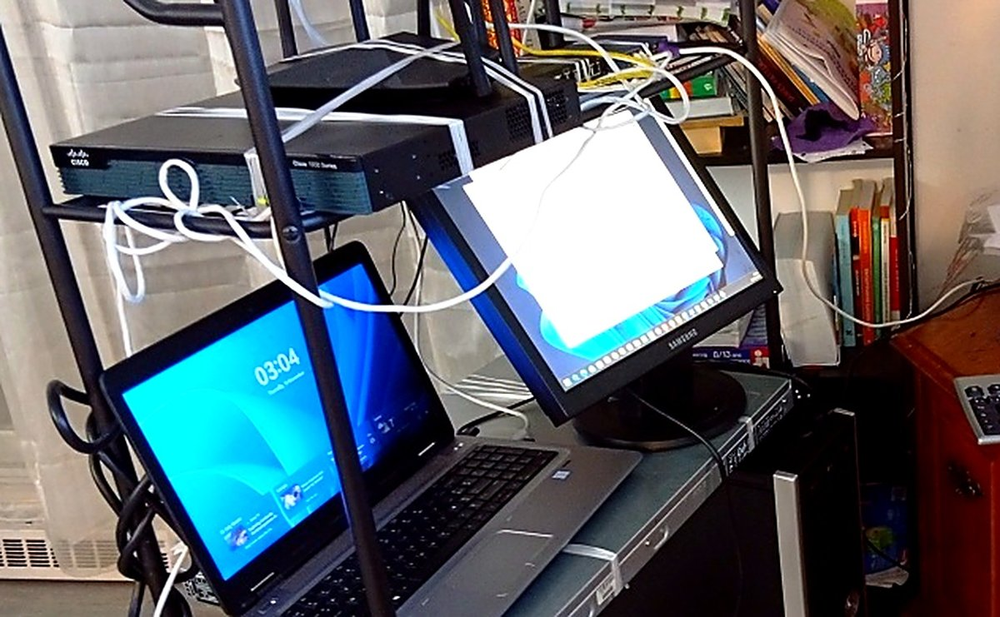
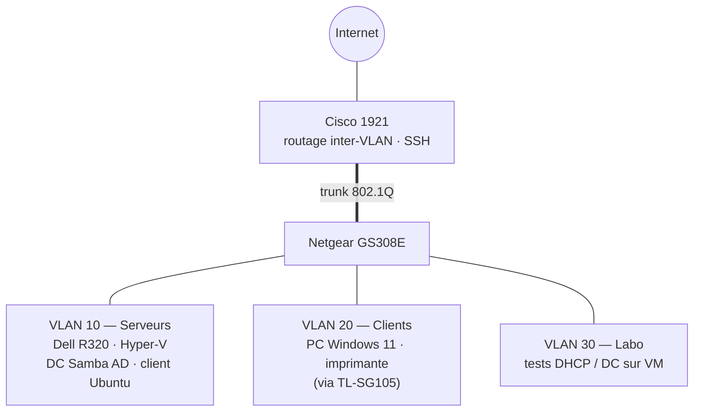

# 🏠 Homelab — Placide Dzeugang

🇫🇷 Mon laboratoire réseau personnel, construit avec du vrai matériel pour pratiquer l'administration des réseaux et des systèmes en dehors des cours de l'AEC **Administration et sécurité des réseaux informatiques** (Cégep Limoilou, Québec). J'y réalise aussi mes travaux pratiques en conditions réelles.

🇬🇧 My personal network lab, built on real hardware to practise network and systems administration beyond my coursework (Network Administration & Security program, Cégep Limoilou, Québec City).



---

## 🧰 Matériel · Hardware

| Équipement | Rôle |
| --- | --- |
| Routeur **Cisco 1921** | Routage inter-VLAN, DHCP du VLAN clients, administration en SSH |
| Commutateur **Netgear GS308E** | Commutateur administrable : VLAN 802.1Q (trunk et accès) |
| Commutateur **TP-Link TL-SG105** | Extension du VLAN clients (imprimante réseau) |
| Serveur **Dell PowerEdge R320** | 4 disques en **RAID 5** (≈ 2,5 To), hyperviseur **Hyper-V** |
| Imprimante **Canon imageCLASS MF264dw** | Imprimante réseau à IP fixe, serveur d'impression CUPS |
| 2 PC **Windows 11** | Postes clients joints au domaine (dont un avec RSAT) |

## 🗺️ Topologie



## 🌐 Plan d'adressage

| VLAN | Nom | Réseau | DHCP |
| --- | --- | --- | --- |
| 10 | Serveurs | 192.168.10.0/24 | Non (adresses fixes) |
| 20 | Clients | 192.168.20.0/24 | Oui, sur le routeur |
| 30 | Labo | 192.168.30.0/24 | Non sur le routeur, pour tester mes propres serveurs DHCP sur des VM sans conflit |

Détails : [docs/plan-adressage.md](docs/plan-adressage.md)

## ⚙️ Services

| Service | Hôte | État |
| --- | --- | --- |
| Contrôleur de domaine **Samba AD** (`samba.lan`) | `srv-ub-dc1` — Ubuntu Server (VM) | ✅ En service |
| Postes Windows 11 joints au domaine | PC-PLACIDE, PLACIDE | ✅ En service |
| Serveur d'impression **CUPS** | client Ubuntu (VM) | 🔧 En cours |
| Contrôleur de domaine Windows Server (révision Serveurs I) | VM dédiée | 📝 Prévu |
| Second contrôleur de domaine Samba | VM Ubuntu | 📝 Prévu |

Documentation : [Samba AD](docs/samba-ad.md) · [Impression CUPS](docs/cups.md)

## 📁 Contenu du dépôt

```
homelab/
├── README.md               ← cette page
├── docs/
│   ├── plan-adressage.md   ← VLAN, sous-réseaux, adresses fixes
│   ├── journal-de-bord.md  ← mises à jour datées du homelab
│   ├── samba-ad.md         ← domaine samba.lan
│   └── cups.md             ← serveur d'impression
├── configs/
│   ├── R1-cisco1921.modele.txt  ← modèle de configuration du routeur
│   └── GS308E-vlans.md          ← affectation des ports du commutateur
└── images/
    └── homelab.jpg
```

## 🔒 Sécurité

Aucun mot de passe, aucune clé et aucune adresse IP publique ne sont publiés dans ce dépôt : ils sont remplacés par `********`.

---

📌 Portfolio : [dzplacide.github.io](https://dzplacide.github.io) · LinkedIn : [placide-dzeugang](https://www.linkedin.com/in/placide-dzeugang/)
